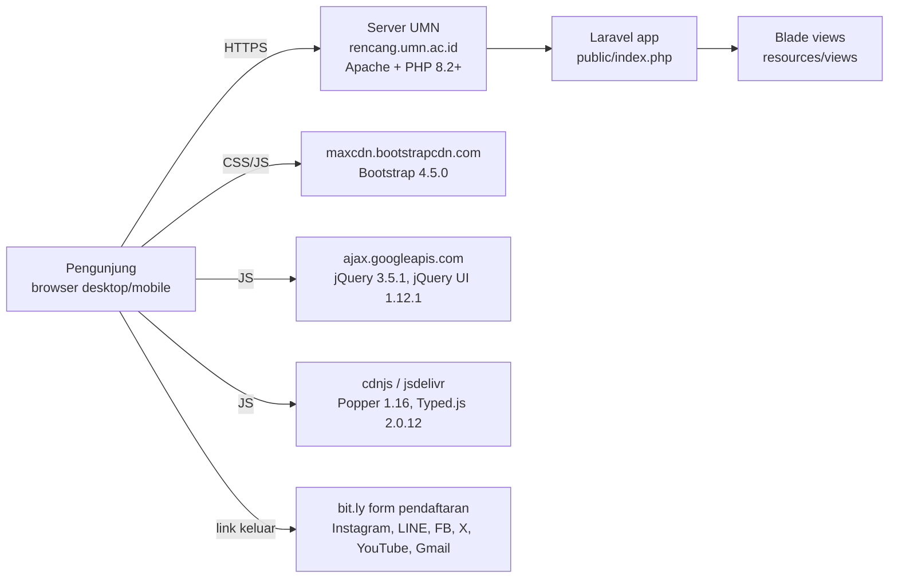
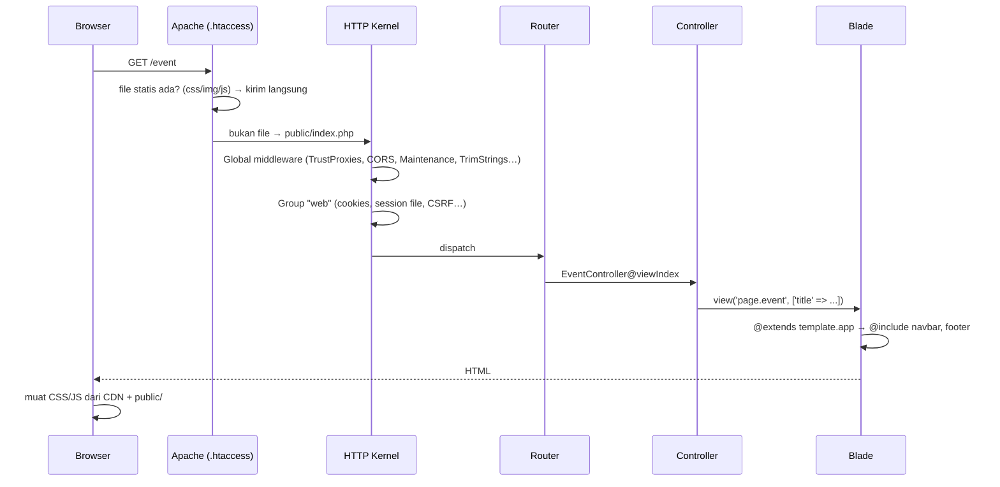

# Arsitektur Website Rencang (rencang.umn.ac.id)

> Dokumen analisis *as-built* dari repo [`FelicianoSurya/Rencang-2022`](https://github.com/FelicianoSurya/Rencang-2022), branch `main` (commit terakhir `3e8ec6e`, 19 Feb 2022).
> Disusun 2 November 2026 sebagai dasar upgrade PHP 8.2 yang diminta IT Infrastructure UMN.
> Dokumen terkait: [PRD.md](PRD.md) · [DESIGN_SYSTEM.md](DESIGN_SYSTEM.md)

---

## 1. Ringkasan eksekutif

| Aspek | Temuan |
|---|---|
| Jenis aplikasi | Website company profile **statis**: 10 halaman informasi, tanpa login, tanpa form, tanpa database |
| Framework | **Laravel 8.83.0** (terkunci di `composer.lock`), PHP `^7.3\|^8.0` |
| Frontend | Blade + **Bootstrap 4.5.0**, **jQuery 3.5.1**, jQuery UI 1.12.1, Typed.js, SweetAlert2, semua lewat CDN kecuali SweetAlert |
| Data | Semua konten (teks, tanggal, gambar) di-*hardcode* di file Blade |
| Database | Dikonfigurasi (MySQL) tapi **tidak pernah dipakai** |
| Ukuran aset | ~93 MB gambar di `public/images`, beberapa file 5–7 MB |
| Riwayat | 5 commit, 6–19 Feb 2022, 2 kontributor (FelicianoSurya, Deiyak) |
| **Status PHP 8.2** | ❌ `composer install` **akan gagal** di PHP 8.2 karena 3 paket terkunci mensyaratkan `php <8.2` (lihat §8) |
| Status framework | Laravel 8 sudah **EOL**: dukungan PHP resmi 7.3–8.1, security fix berakhir Januari 2023 |

**Kesimpulan:** kode aplikasinya sendiri sangat kecil dan tidak memakai fitur PHP yang dihapus atau usang. Masalahnya ada di **versi framework dan dependensi**. Karena aplikasinya hampir murni tampilan, jalur paling aman adalah memindahkan kode ke skeleton Laravel versi baru (lihat §8.3).

---

## 2. Konteks sistem



Tidak ada integrasi backend ke layanan lain: tidak ada API, mail, queue, atau storage eksternal. Semua interaksi pengguna hanya navigasi atau tautan keluar.

---

## 3. Tech stack

### 3.1 Backend (dari `composer.lock`)

| Paket | Versi terkunci | Dipakai? | Catatan |
|---|---|---|---|
| `laravel/framework` | 8.83.0 | Ya | EOL. Versi terakhir seri 8 adalah 8.83.27 |
| `fruitcake/laravel-cors` | 2.0.5 | Middleware aktif, tidak dibutuhkan | Paket sudah *abandoned*. CORS sudah bawaan sejak Laravel 9 |
| `laravel/sanctum` | 2.14.0 | **Tidak** | Middleware Sanctum dikomentari |
| `laravel/tinker` | 2.7.0 | Hanya dev | – |
| `guzzlehttp/guzzle` | 7.4.1 | **Tidak** | Tidak ada HTTP call keluar |
| `nesbot/carbon` | 2.56.0 | Tidak langsung | Transitif dari framework |
| `nette/schema` | 1.2.2 | Transitif | ⚠️ `php >=7.1 <8.2` |
| `nette/utils` | 3.2.7 | Transitif | ⚠️ `php >=7.2 <8.2` |
| `phpspec/prophecy` (dev) | 1.15.0 | Dev | ⚠️ `php ^7.2 \|\| ~8.0, <8.2` |
| `facade/ignition` (dev) | 2.17.4 | Dev | Error page Laravel 8 |

### 3.2 Frontend

| Library | Versi | Sumber | Dipakai di |
|---|---|---|---|
| Bootstrap CSS + JS | 4.5.0 | `maxcdn.bootstrapcdn.com` | Semua halaman: grid, navbar collapse, carousel. Komentar di kode keliru menyebut "Bootstraps 5" |
| jQuery | 3.5.1 | Google CDN | Semua halaman |
| jQuery UI (CSS + JS) | 1.12.1 | Google CDN | **Tidak dipakai sama sekali**. Versi ini punya CVE XSS (CVE-2021-41182/41183/41184) |
| Popper.js | 1.16.0 | cdnjs | Dibutuhkan Bootstrap 4 dropdown |
| Typed.js | 2.0.12 | jsDelivr | `home` (efek ketik "Kawan/Teman/Sahabat"). Juga dimuat di `WhoWeAre` tapi tidak dipakai |
| SweetAlert2 | (bundel lokal 67 KB) | `public/js/sweetalert/sweetalert.js` | Hanya popup "Coming Soon" Rencang Night di `event` |
| Laravel Mix 6 | – | `package.json` | **Tidak dipakai**. `resources/js/app.js` dan `resources/css/app.css` kosong dan tidak di-include di layout |

### 3.3 Runtime dan hosting (asumsi dari repo)

- **Apache + mod_rewrite**: `public/.htaccess` standar Laravel. Ada juga `public/web.config` untuk IIS (bawaan skeleton).
- Document root harus menunjuk ke `public/`. Belum terverifikasi; perlu dicek ke IT.
- `.env` tidak ada di repo (benar, di-*gitignore*). Yang tersedia hanya `.env.example` bawaan Laravel (`APP_NAME=Laravel`, `APP_DEBUG=true`).

---

## 4. Struktur direktori

```
rencang-website/
├── app/
│   ├── Http/
│   │   ├── Controllers/        # 9 controller, masing-masing 1 method viewIndex()
│   │   ├── Middleware/         # 8 middleware bawaan Laravel 8, tidak dimodifikasi
│   │   └── Kernel.php          # bawaan, + Fruitcake\Cors\HandleCors
│   ├── Models/User.php         # bawaan, tidak dipakai
│   └── Providers/              # bawaan
├── config/                     # bawaan; timezone 'UTC', locale 'en'
├── database/migrations/        # 4 migrasi bawaan (users, password_resets, failed_jobs, personal_access_tokens), tidak dipakai
├── public/
│   ├── css/<halaman>/*.css     # 12 file CSS, satu per halaman
│   ├── fonts/                  # Baloo Paaji 2, Merriweather, MADE TOMMY, Sketcha (.ttf/.otf)
│   ├── images/                 # ~93 MB, dikelompokkan per halaman/event
│   ├── js/navbar/navbar.js     # tidak di-include di mana pun (dead file)
│   ├── js/sweetalert/          # SweetAlert2 lokal
│   ├── favicon.ico             # 0 byte (kosong)
│   └── index.php, .htaccess
├── resources/views/
│   ├── template/               # app (layout), navbar, footer
│   ├── page/                   # 11 halaman
│   └── welcome.blade.php       # bawaan Laravel, tidak di-route
└── routes/web.php              # semua route
```

---

## 5. Routing dan alur request

### 5.1 Tabel route (`routes/web.php`)

| Method | URI | Nama route | Controller@method | View | `$title` |
|---|---|---|---|---|---|
| GET | `/` | `home` | `HomeController@viewIndex` | `page.home` | Rencang |
| GET | `/what-we-do` | `wwd` | `WhatWeDoController@viewIndex` | `page.WhatWeDo` | Rencang - What We Do |
| GET | `/who-we-are` | `wwa` | `WhoWeAreController@viewIndex` | `page.WhoWeAre` | Rencang - Who We Are |
| GET | `/event` | `event` | `EventController@viewIndex` | `page.event` | Rencang - Event |
| GET | `/gedurasi` | `gedurasi` | `GedurasiController@viewIndex` | `page.gedurasi` | Rencang - Gedurasi |
| GET | `/sentera` | `sentera` | `SenteraController@viewIndex` | `page.sentera` | Rencang - Sentera |
| GET | `/sharing-caring-helping` | `sch` | `SCHController@viewIndex` | `page.sch` | Rencang - SCH |
| GET | `/rencang-cepat-tanggap` | `rct` | `RencangCTController@viewIndex` | `page.rencangCT` | Rencang - RCT |
| GET | `/keakraban` | `keakraban` | `KeakrabanController@viewIndex` | `page.Keakraban` | Rencang - Keakraban |
| GET | `/soon` | `soon` | Closure | `page.soon` | Coming Soon |
| ANY | `{query}` (`.*`) | – | Closure | – | Redirect 302 ke `/` |

Catatan:
- Route `/gedurasi` **didefinisikan dua kali** (baris 26 dan 30). Tidak error, tapi redundan.
- *Catch-all* `Route::any('{query}')` mengalihkan **semua** URL tak dikenal ke beranda. Akibatnya:
  - tidak pernah ada halaman 404, sehingga tautan rusak sulit dideteksi;
  - aset yang hilang (misalnya `css/home/home.css` yang direferensikan `page/template.blade.php`) dibalas HTML beranda, bukan 404.
- Nama view memakai huruf besar/kecil campuran (`WhoWeAre`, `Keakraban`). Saat ini sudah cocok dengan nama file, tapi rawan rusak di server Linux yang peka huruf kalau ada yang mengganti nama file.

### 5.2 Alur request



Setiap request membuka sesi berbasis file (`storage/framework/sessions`) walau tidak ada fitur yang memakai sesi. Ini *overhead* kecil yang tidak diperlukan, dan berarti folder `storage/` **harus writable** di server.

---

## 6. Lapisan presentasi

### 6.1 Layout

`template/app.blade.php` adalah satu-satunya layout:

```
<head>  title={{ $title }}, favicon, Bootstrap 4 CSS, jQuery UI CSS, navbar.css, footer.css
        @yield('custom-css')        ← tiap halaman menyuntik CSS-nya sendiri
<body>  @include('template.navbar')
        @yield('content')
        @include('template.footer')
        jQuery, jQuery UI, Popper, Bootstrap JS, SweetAlert
        <script> logika dropdown hover + penanda menu aktif </script>
        @yield('custom-js')
```

**Penanda menu aktif** memakai segmen terakhir `window.location.pathname` sebagai id elemen (`#home`, `#what-we-do`, …). Untuk `/` hasilnya string kosong, sehingga menu Home tidak pernah ditandai aktif.

### 6.2 Halaman dan pola

| Pola | Halaman | Struktur |
|---|---|---|
| **Landing** | `home` | Hero ilustrasi + teks Typed.js → banner event (CARITAS + countdown + tombol Daftar) → "Apa itu Rencang?" → ilustrasi rumah |
| **Profil** | `WhoWeAre` | Banner foto berbingkai → Profil → "Arti Kata Rencang" (kartu kamus interaktif) → Logo → Tujuan → Visi & Misi → Esensi |
| **Kategori** | `WhatWeDo` | Header foto → 4 kartu kategori (Tahunan, Unggulan, Keakraban, Insidental) → "Periode Event" (1 kartu Gen 13/14 → `/event`) |
| **Hub event** | `event` | Header → tagline Gen XIII → 6 logo bulat (tab) → panel deskripsi event + "View More >>" |
| **Detail program** | `gedurasi`, `sentera`, `sch`, `rencangCT` | Hero judul + tagline → label program + tanggal → 2 blok gambar+teks → Dokumentasi (grid desktop / carousel mobile) |
| **Detail keakraban** | `Keakraban` | Header → 5 blok gambar+teks bergantian (Makrab, Anniv, I Care For You, Curhat, Piknik) |
| **Placeholder** | `soon` | Teks "COMING SOON" di tengah layar |

Ada dua file view yang tidak dipakai: `page/template.blade.php` (kerangka kosong yang mereferensikan `css/home/home.css`, file yang tidak ada) dan `welcome.blade.php`.

### 6.3 Interaktivitas (JS)

| Fitur | Lokasi | Implementasi |
|---|---|---|
| Dropdown "Who We Are?" | layout | jQuery `hover`/`click` show/hide manual, menimpa perilaku Bootstrap |
| Efek ketik "Halo, Sahabat" | home | Typed.js |
| Countdown CARITAS | home | `setInterval`. Target `2022-02-24 18:00:00` di-*hardcode* di `HomeController` (zona waktu browser), jadi sejak Feb 2022 hanya tampil `00` |
| Tab event | event | 6 fungsi `gedurasi()`, `sentera()`, … yang masing-masing men-set `display` 6 elemen (duplikasi 36 baris) |
| Tombol "View More" | event | `if/else` id → `window.location`; Rencang Night → SweetAlert "Coming Soon" |
| Kartu kamus | WhoWeAre | Kursor berkedip `setTimeout` + `fadeIn` terjemahan |
| Tautan sosmed | footer | ``, bukan `<a>` |
| Kartu periode | WhatWeDo | `$('#14').click(...)` |

---

## 7. Keamanan, kinerja, dan kualitas

### 7.1 Keamanan

| # | Temuan | Risiko | Rekomendasi |
|---|---|---|---|
| S1 | Laravel 8 EOL, tidak menerima security patch sejak Jan 2023 | Tinggi | Upgrade framework (§8) |
| S2 | jQuery UI 1.12.1 dimuat padahal tidak dipakai, dan punya CVE XSS | Sedang (tidak ada input user, jadi sulit dieksploitasi) | Hapus |
| S3 | Script CDN tanpa Subresource Integrity (`integrity=`) | Rendah–sedang | Tambah SRI atau host lokal |
| S4 | `.env.example` default `APP_DEBUG=true`. Kalau `.env` produksi ikut nilai ini, stack trace terbuka ke publik | Tinggi bila terjadi | Pastikan `APP_ENV=production`, `APP_DEBUG=false` |
| S5 | Tidak ada security header (CSP, X-Frame-Options, dll.) | Rendah | Tambah via `.htaccess` atau middleware |
| S6 | Paket tak terpakai (Sanctum, Guzzle, CORS) memperbesar permukaan serangan | Rendah | Buang saat upgrade |

Tidak ditemukan SQL query, upload, form, atau input pengguna, sehingga permukaan serangan aplikasinya sendiri sangat kecil.

### 7.2 Kinerja

- **Total gambar ~93 MB**. Yang terbesar: `SENTERA/Foto SENTERA.JPG` 7,2 MB, `Gedurasi/foto bareng.png` 7,1 MB, `home/picture.JPG` dan `what-we-do/picture.JPG` masing-masing 5,9 MB.
- Tidak ada `loading="lazy"`, `srcset`, atau format modern (WebP/AVIF).
- Font dimuat sebagai `.ttf`/`.otf` (tidak dikompresi). `@font-face` dideklarasi ulang di tiap CSS halaman tanpa `font-display`.
- 4 domain CDN berbeda berarti 4 handshake DNS/TLS tambahan.
- CSS per halaman tidak di-minify. Mix tersedia tapi tidak dipakai.

### 7.3 Utang teknis (ringkas)

1. Konten di-*hardcode* di Blade: setiap ganti event atau periode harus edit kode.
2. Duplikasi markup: galeri ditulis dua kali (grid + carousel), CSS `@font-face` diulang di 10 file.
3. 9 controller identik yang hanya me-*return* view. Bisa diganti `Route::view()`.
4. File mati: `welcome.blade.php`, `page/template.blade.php`, `js/navbar/navbar.js`, migrasi, model `User`, Mix.
5. Path gambar tanpa `asset()` di `sch.blade.php` (`src="images/SCH/..."`), yang akan rusak kalau app tidak di-root domain.
6. Nama file aset mengandung spasi dan huruf besar/kecil campuran (`Foto SENTERA.JPG`, `Logo GEDURASI.png`).
7. Tidak ada test (hanya `ExampleTest` bawaan).
8. Konten basi: CARITAS (Feb 2022), footer "© 2020", event Gen 13 & 14.

---

## 8. Kesiapan PHP 8.2

### 8.1 Kode aplikasi

Hasil scan `app/`, `config/`, `routes/`, `resources/`, `database/`, `public/index.php`:

| Pola rawan PHP 8.x | Ditemukan? |
|---|---|
| `mysql_*`, `each()`, `create_function()`, `money_format()` (dihapus 7.x/8.0) | Tidak |
| `utf8_encode/decode`, interpolasi `${var}` (usang 8.2) | Tidak |
| `FILTER_SANITIZE_STRING`, `strftime` (usang 8.1) | Tidak |
| Dynamic properties di class sendiri (usang 8.2) | Tidak (tidak ada class buatan sendiri selain controller kosong) |

**Kode buatan tim aman untuk PHP 8.2.** Semua masalah ada di vendor.

### 8.2 Dependensi (blocker)

`composer.lock` mengunci paket yang menolak PHP 8.2:

| Paket | Versi | Syarat PHP | Jenis |
|---|---|---|---|
| `nette/schema` | 1.2.2 | `>=7.1 <8.2` | Produksi (transitif dari `league/commonmark` ← Laravel) |
| `nette/utils` | 3.2.7 | `>=7.2 <8.2` | Produksi (transitif) |
| `phpspec/prophecy` | 1.15.0 | `^7.2 \|\| ~8.0, <8.2` | Dev saja |

Akibatnya, `composer install` di PHP 8.2 akan berhenti dengan error *"your php version does not satisfy that requirement"*. Selain itu, **Laravel 8 resmi hanya mendukung PHP 7.3–8.1**, jadi walau dipaksa jalan, kemungkinan besar muncul *deprecation notice* dari vendor dan tidak ada jaminan kompatibilitas.

### 8.3 Opsi upgrade

| | Opsi A: *Patch* di Laravel 8 | **Opsi B: Pindah ke Laravel versi terbaru (disarankan)** | Opsi C: Jadikan HTML statis |
|---|---|---|---|
| Langkah | `composer update` di dalam batas `^8.75` agar `nette/*` naik ke versi yang mengizinkan 8.2 | Buat skeleton Laravel baru, lalu salin `routes`, `resources/views`, `public/{css,js,fonts,images}` | Render tiap halaman ke `.html`, buang PHP |
| Effort | ~1 jam | ~3–6 jam | ~3–5 jam + perlu izin IT |
| Kompatibel PHP 8.2 | Sebagian (Laravel 8 tidak resmi mendukung 8.2) | ✅ Resmi | ✅ Tidak butuh PHP |
| Security patch framework | ❌ EOL sejak 2023 | ✅ Masih didukung | N/A |
| Risiko ditolak IT | Sedang | Rendah | Bergantung kebijakan hosting |

**Rekomendasi: Opsi B.** Aplikasinya hanya 1 file route + 13 view + aset statis, jadi pindah ke skeleton baru lebih murah dan lebih bersih daripada upgrade bertahap 8 → 9 → 10 → 11 → 12. Pilih versi Laravel yang (1) mendukung versi PHP persis di server UMN dan (2) masih menerima security fix. Hasil cek ke Packagist (2 Nov 2026): **Laravel 12.70.2 membutuhkan PHP ^8.2** dan **Laravel 13.39.0 membutuhkan PHP ^8.3**. Menurut tabel dukungan resmi Laravel, **security fix Laravel 12 berakhir 24 Februari 2027**, sedangkan Laravel 13 (PHP 8.3–8.5) didukung sampai sekitar Q1 2028 (<https://laravel.com/docs/releases#support-policy>). Jadi Laravel 12 hanya jembatan, dan **Laravel 13 lebih tepat bila server UMN menjalankan PHP 8.3 atau lebih baru**. Rencana lengkapnya ada di [AUDIT_DAN_ROADMAP.md](AUDIT_DAN_ROADMAP.md). Versi PHP persis di server harus dikonfirmasi ke IT sebelum memilih.

Kalau waktu sangat mepet (tenggat IT ±3 Nov 2026), Opsi A bisa jadi langkah darurat supaya situs bisa dibuka lagi, lalu lanjut ke Opsi B.

### 8.4 Perubahan yang diperlukan saat migrasi ke Laravel baru

| Area | Laravel 8 (sekarang) | Laravel 11+ | Tindakan |
|---|---|---|---|
| Struktur | `app/Http/Kernel.php`, banyak provider | Disederhanakan ke `bootstrap/app.php` | Jangan salin `Kernel.php`, `Middleware/`, `Providers/` |
| CORS | `fruitcake/laravel-cors` | Bawaan | Hapus paket |
| Controller | 9 controller 1 baris | – | Opsional: ganti dengan `Route::view('/x', 'page.x', ['title' => ...])` |
| Session/DB | Default MySQL + session file | Default SQLite + session **database** | Set `SESSION_DRIVER=file` (atau `array`) dan `DB_CONNECTION` tidak dipakai, supaya tidak perlu database |
| Frontend build | Laravel Mix | Vite | Tidak relevan; aset tetap di `public/` |
| Catch-all redirect | `Route::any('{query}')` | Sama | Pertimbangkan diganti halaman 404 |

Langkah lengkap akan dibuat sebagai panduan terpisah setelah versi PHP server dikonfirmasi.

---

### 8.5 Hasil uji lokal (2 Nov 2026, PHP 8.2.12)

- `composer install` apa adanya gagal di PHP 8.2 karena `nette/*` dan `phpspec/prophecy` (lihat §8.2). Setelah `composer update nesbot/carbon facade/ignition nette/schema nette/utils phpspec/prophecy`, aplikasi berjalan: **10 route membalas HTTP 200**, URL tak dikenal membalas 302 ke `/`.
- Paket yang naik: `nesbot/carbon` 2.56.0 → 2.73.0 (penyebab `TypeError` di PHP 8.2), `nette/utils` 3.2.7 → 4.1.6, `nette/schema` 1.2.2 → 1.4.0, `facade/ignition` 2.17.4 → 2.17.7, `phpspec/prophecy` 1.15.0 → 1.22.0.
- `composer audit` (Composer 2.9.2) masih melaporkan **54 advisory di 13 paket**, terbanyak di `guzzlehttp/guzzle` (14), `guzzlehttp/psr7` (6), dan komponen Symfony 5.4. Guzzle tidak dipakai aplikasi, tetapi tetap terpasang.
- Composer 2.9 **memblokir versi yang punya advisory** saat `update`. Karena advisory "CRLF injection di rule email Laravel" berlaku untuk seluruh seri 8 (rentang `<12.60.0`), `composer update` biasa menarik Laravel dari *dev branch* `8.x-dev`, bukan rilis stabil. Dengan `--no-security-blocking`, Composer memilih rilis stabil `v8.83.29`. Aplikasi tidak memakai validasi email, tetapi seri 8 tidak akan pernah mendapat perbaikan tersebut.
- `composer.json` masih mengizinkan `"php": "^7.3|^8.0"` dan `"minimum-stability": "dev"`. Keduanya sebaiknya diperketat.

## 9. Pertanyaan terbuka untuk IT / pengurus

1. Versi PHP **persis** di server (`8.2.x`, `8.3.x`, `8.4.x`)? Ini menentukan versi Laravel target.
2. Bagaimana cara deploy: FTP, cPanel, atau SSH? Apakah `composer` tersedia di server, atau `vendor/` harus diunggah?
3. Apakah document root sudah menunjuk ke `public/`?
4. Apakah repo GitHub ini sama persis dengan yang ter-deploy? (Commit terakhir Feb 2022; bisa jadi ada edit langsung di server.)
5. Siapa pemegang akses server dan repo sekarang?
